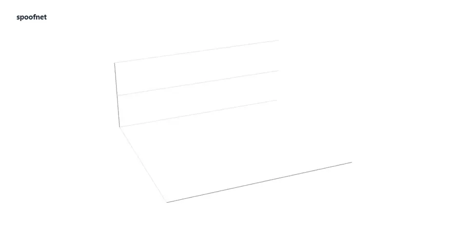

# SpoofNet

GNSS jamming and spoofing, mapped from phones.



<sub>From the repository's results files, as summarised in `REPORT.md`. Simulated phones in replay; the only real interference in the data is one flight with one jamming event.</sub>

<picture>
  <source media="(max-width: 600px) and (prefers-color-scheme: dark)" srcset=".github/assets/rule-mobile-01-dark.svg">
  <source media="(max-width: 600px)" srcset=".github/assets/rule-mobile-01-light.svg">
  <source media="(prefers-color-scheme: dark)" srcset=".github/assets/rule-01-dark.svg">
  
</picture>

SpoofNet detects GPS and other satellite navigation (GNSS) jamming and spoofing from the raw
measurements that Android phones already report: signal strength per satellite, receiver gain and
clock. Reports from several phones are grouped into incidents, the source is located with an
uncertainty ellipse, and the result is served through an HTTP API and a web map. It is passive
detection only. Nothing in this repository transmits.

It is a research prototype. The detection numbers come from simulated phones and from real phone
logs with synthetic interference added. On real interference there is one observation: one jamming
event on one public flight log. The Android app only logs and has never been built.

<picture>
  <source media="(max-width: 600px) and (prefers-color-scheme: dark)" srcset=".github/assets/rule-mobile-02-dark.svg">
  <source media="(max-width: 600px)" srcset=".github/assets/rule-mobile-02-light.svg">
  <source media="(prefers-color-scheme: dark)" srcset=".github/assets/rule-02-dark.svg">
  
</picture>

**The problem.** Public interference maps such as GPSJam and the Flightradar24 layer are built from
the navigation accuracy that aircraft broadcast. They show the sky. Ports, shipping lanes, roads and
fields at ground and sea level have no such view, and a blank cell there means no data, not no
interference.

**What was missing.** Single-phone cues exist: Google's GnssLogger shows C/N0 and gain falling
together as a jamming hint. A JRC research app (CrowdShield) detected jamming with phone gain readings
at Jammertest 2025. What this repository adds is a measured false-alarm rate across everyday
obstructions, detection on phones without gain readings, spoofing and meaconing checks in one score,
multi-phone source localisation with a stated uncertainty, and a privacy design where tracks stay
on the phone.

**Who it is for.** The one-pagers in [`docs/pitch/`](docs/pitch/) address marine insurers, port
authorities, fleet operators, precision agriculture and telecom timing. None of them is a customer.

Prior art and sources: [`DESIGN.md`](DESIGN.md) section 0.

<picture>
  <source media="(max-width: 600px) and (prefers-color-scheme: dark)" srcset=".github/assets/rule-mobile-03-dark.svg">
  <source media="(max-width: 600px)" srcset=".github/assets/rule-mobile-03-light.svg">
  <source media="(prefers-color-scheme: dark)" srcset=".github/assets/rule-03-dark.svg">
  
</picture>

1. **Raw log.** One logging session, resampled to 1 Hz: C/N0 per satellite and band, receiver gain
   (AGC) where the phone reports it, clock, pseudoranges, Doppler and a motion summary. It comes from a
   GnssLogger-format text file or from the simulator.
2. **Features.** Each signal keeps an adaptive C/N0 baseline that freezes while the signal looks
   suspicious, so interference is not learned as normal. Features compare gain, clock, constellations
   and bands against that baseline.
3. **Detector.** Evidence terms are combined in a logistic score. Every weight and threshold is
   fitted on replay data and stored in [`config/detector.json`](config/detector.json). Output is a typed
   event (`jam`, `spoof`, `meacon`) with reason codes. When all signals fade and the phone has no gain
   reading, it reports `loss_unknown` instead of guessing between a jammer and a tunnel.
4. **Event.** What leaves the phone is a type, a score, a coarse map cell and the C/N0 loss, under a
   token that changes every day and per region. Raw measurements and tracks do not leave.
5. **Incident.** Events close in space and time are clustered. An incident opens when at least three
   distinct contributors agree. Its type is a weighted vote.
6. **Locate.** Phones nearer the source lose more signal. A path-loss fit over the reported losses
   gives a source position and a 95% ellipse.
7. **Publish.** The public view shows coarse cells, at least three contributors, delayed by
   15 minutes, with no source estimate. Customers get finer cells. Vetted users get the source.
   The map draws areas without phones as no data.

<picture>
  <source media="(max-width: 600px) and (prefers-color-scheme: dark)" srcset=".github/assets/rule-mobile-04-dark.svg">
  <source media="(max-width: 600px)" srcset=".github/assets/rule-mobile-04-light.svg">
  <source media="(prefers-color-scheme: dark)" srcset=".github/assets/rule-04-dark.svg">
  
</picture>

What the code does today. Detection runs in Python, on simulated phones and on recorded logs.

- **Log reader and writer.** GnssLogger-format text logs, header-driven, with pseudoranges rebuilt
  from the raw clock fields. `spoofnet/io/gnsslogger.py`
- **Broadcast ephemeris.** RINEX 3 navigation files for GPS, Galileo and BeiDou MEO/IGSO. GLONASS and
  BeiDou GEO positions are not implemented. `spoofnet/io/rinex_nav.py`
- **Simulator.** Constellations, receiver models calibrated to five public phone logs, environments
  (tunnel, garage, street canyon, forest, boat, car) and synthetic interference applied to the
  measurements. `spoofnet/sim`
- **Detectors.** Features, per-device and per-place baselines, logistic fusion and an event state
  machine for jamming, spoofing and meaconing. `spoofnet/detect`
- **Replay and calibration.** Cached replay, fitting of every constant, held-out scoring.
  `spoofnet/replay`, `experiments/`
- **Network.** Daily contributor tokens, H3 cells, incident clustering, classification, source
  localisation and an ADS-B cross-check against prepared aggregate tables. `spoofnet/net`
- **Server.** FastAPI on SQLite: public incidents and coverage, event and coverage upload, and
  key-protected incidents, CSV export, risk heatmap, geofences and alerts for customer and vetted
  tiers. `spoofnet/server`
- **Web map.** Static MapLibre map that reads the API or the committed snapshot. `web/`
- **Android.** Kotlin SDK and app that log raw GNSS data and probe the phone's capabilities. No
  detector, no uploader. Never compiled. `android/`

Results from [`REPORT.md`](REPORT.md). `replay` means simulated phones, or recorded logs with
synthetic interference. `real` means recorded under real interference.

| Measure | Target | Result | Label |
|---|---|---|---|
| Moderate jamming detected, per phone | ≥ 95% | 49% of 250 (87% with gain and a second band, 16% with neither) | `replay` |
| Spoofing detected, consistent pseudoranges | ≥ 85% | 100% of 200 | `replay` |
| False alarms per device-hour | < 0.01 | 0.0031 (4 in 1 286 h) | `replay` |
| Network time to incident, median | ≤ 60 s | 6.2 s | `replay` |
| Source localisation, median error | ≤ 500 m | 280 m | `replay` |
| Source inside its 95% ellipse | 95% | 79% | `replay` |
| Jamming events on one flight log through a documented interference area | | 1, matching the aircraft-based map | `real` |
| Battery cost | < 5%/day | not measured, no phone | |

Known weak points, from the same report:

- The jamming target is missed. Without gain readings a phone sees jamming only as lower C/N0, and
  so does a roof.
- Slow drag-off spoofing is found 49% of the time, after about a minute.
- Uncertainty ellipses are too small: 79% coverage where 95% is claimed.
- Nothing has been measured at ground or sea level under real interference. No real spoofing log has
  been processed.
- No ADS-B feed is connected. Attestation and the region list are designed, not built.

<picture>
  <source media="(max-width: 600px) and (prefers-color-scheme: dark)" srcset=".github/assets/rule-mobile-05-dark.svg">
  <source media="(max-width: 600px)" srcset=".github/assets/rule-mobile-05-light.svg">
  <source media="(prefers-color-scheme: dark)" srcset=".github/assets/rule-05-dark.svg">
  
</picture>

Requires Python 3.10 or newer. H3 cells need either the `h3` Python package or Node.js. Commands
below were run on Windows 11 with Python 3.15 and Node 26, where `h3` has no build, so the Node bridge
is used. On macOS or Linux use `.venv/bin/python` instead of `.venv/Scripts/python`; that path was not
tested.

```bash
git clone https://github.com/hesselb20-ctrl/spoofnet.git
cd spoofnet
python -m venv .venv
.venv/Scripts/python -m pip install -e ".[server,dev]" httpx
cd spoofnet/net/h3bridge && npm ci && cd ../../..
```

`httpx` is needed only for the HTTP API test. Without it that test is skipped. Without the Node step,
or `h3`, most tests fail with `H3 is unavailable`.

Run the tests. Expect `41 passed`.

```bash
.venv/Scripts/python -m pytest -q
```

Print every headline number from the committed results in `results/`.

```bash
.venv/Scripts/python experiments/summarise.py
```

Open the map at `http://127.0.0.1:8080/`. It reads the committed snapshot in `web/data/`, which is
simulated and labelled so, and loads tiles from OpenStreetMap.

```bash
.venv/Scripts/python -m http.server 8080 --directory web
```

Start the API at `http://127.0.0.1:8787/v1/public/meta`. It creates an empty `spoofnet.sqlite`, so the
map it serves at `/` shows no incidents until events are uploaded. Customer and vetted routes return
403 without a key.

```bash
.venv/Scripts/python -m uvicorn spoofnet.server.app:app --port 8787
```

Not run here: refitting the detector (`experiments/detector_pipeline.py`), the real-log scripts, which
need the [Zenodo 14712684](https://zenodo.org/records/14712684) logs, and the Android build. See
[`REPORT.md`](REPORT.md), [`docs/validation/real_world.md`](docs/validation/real_world.md) and
[`android/README.md`](android/README.md).

The same map with the same snapshot is published at
[hesselb20-ctrl.github.io/spoofnet/map](https://hesselb20-ctrl.github.io/spoofnet/map/).

<picture>
  <source media="(max-width: 600px) and (prefers-color-scheme: dark)" srcset=".github/assets/rule-mobile-06-dark.svg">
  <source media="(max-width: 600px)" srcset=".github/assets/rule-mobile-06-light.svg">
  <source media="(prefers-color-scheme: dark)" srcset=".github/assets/rule-06-dark.svg">
  
</picture>

**Stack**

| Layer | Built with |
|---|---|
| Detectors, simulator, replay, network | Python 3.10+, NumPy, SciPy |
| H3 cells | `h3` package, or `h3-js` through a Node bridge |
| Server | FastAPI, uvicorn, SQLite |
| Map | MapLibre GL, OpenStreetMap and OpenSeaMap tiles, no build step |
| Android SDK and app | Kotlin, Gradle, minSdk 26 |
| Project site | GitHub Pages, deployed by `.github/workflows/pages.yml` |

**Status**

| Part | State |
|---|---|
| Detectors | Built. Measured in replay. Hardened and checked on five public real-phone logs. |
| Network aggregation and localisation | Built. Measured on simulated multi-phone scenarios only. |
| API and map | Run locally. The map and its simulated snapshot are on GitHub Pages. The API is not deployed. Postgres schema written, not used. |
| Android app | Logging and capability probe only. Never compiled or installed. |
| Real interference | One jamming event on one flight log. Nothing at ground or sea level. No real spoofing. |
| CI | Pages deploy only. Tests do not run in CI. |

**Roadmap.** The three next steps in the report:

1. Build the logger and run it on 20 phones for a week on one route with documented interference,
   such as a Baltic ferry route or port. Stop if there are more than three false alarms in 300
   device-hours.
2. Get ground truth: apply to Jammertest 2027 and contact the JRC authors of the 2025 phone study.
3. Test willingness to pay with ten conversations in one segment, starting with marine underwriters,
   before building more.

**Documents**

| File | Contents |
|---|---|
| [`REPORT.md`](REPORT.md) | Results per milestone, what failed, next steps |
| [`DESIGN.md`](DESIGN.md) | Prior art, detectors, false-alarm strategy, privacy, publication rules, targets |
| [`THREAT_MODEL.md`](THREAT_MODEL.md) | What can and cannot be detected, threats to the system and contributors |
| [`docs/validation/real_world.md`](docs/validation/real_world.md) | Real-phone results in full |
| [`docs/device_matrix.md`](docs/device_matrix.md) | Tested phones, empty until a real capability report exists |
| [`docs/RESPONSIBLE_DISCLOSURE.md`](docs/RESPONSIBLE_DISCLOSURE.md) | Disclosure policy |
| [`docs/pitch/`](docs/pitch/) | One-pagers per sector and a technical validation note |
| [`android/README.md`](android/README.md) | Logger app and SDK, and the first-build checklist |
| [`docs/media/spoofnet-tutorial.mp4`](docs/media/spoofnet-tutorial.mp4?raw=true) | 72-second explainer, no sound, 4.7 MB download. Also on the [project site](https://hesselb20-ctrl.github.io/spoofnet/) |

<picture>
  <source media="(max-width: 600px) and (prefers-color-scheme: dark)" srcset=".github/assets/rule-mobile-07-dark.svg">
  <source media="(max-width: 600px)" srcset=".github/assets/rule-mobile-07-light.svg">
  <source media="(prefers-color-scheme: dark)" srcset=".github/assets/rule-07-dark.svg">
  
</picture>

No license file yet. All rights reserved until one is added.

Third-party data keeps its own terms. Map data © OpenStreetMap contributors (ODbL), sea marks
© OpenSeaMap. Real-phone logs: E. Takiguchi Medina and E. S. Lohan, Zenodo 10.5281/zenodo.14712684,
CC BY 4.0. Aircraft comparison: GPSJam daily data. OpenSky Network data may be used for research and
non-profit work only.
