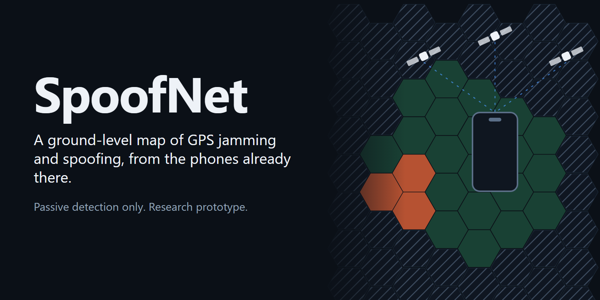
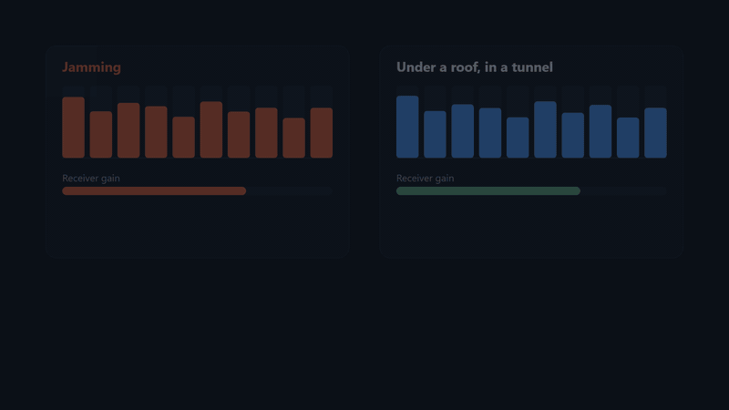
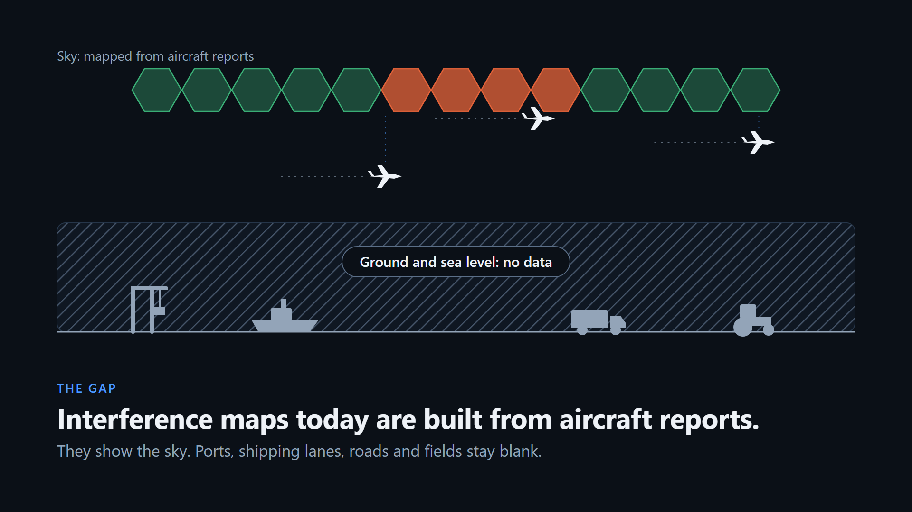
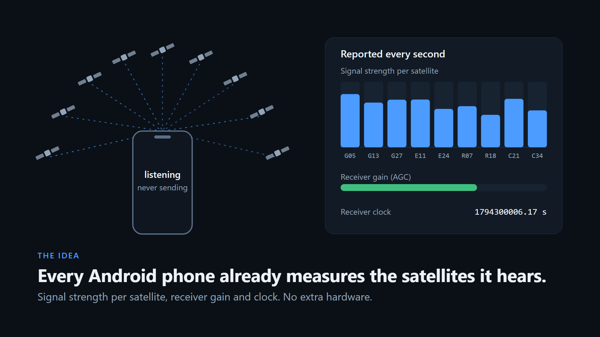
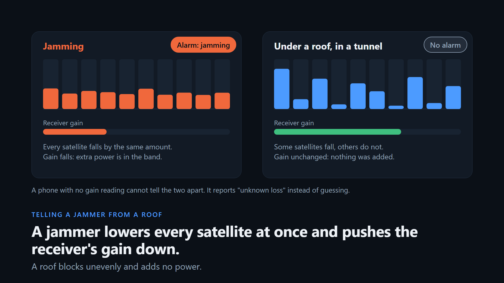
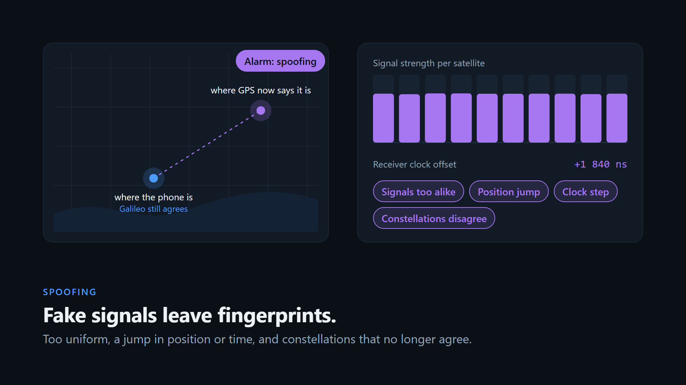
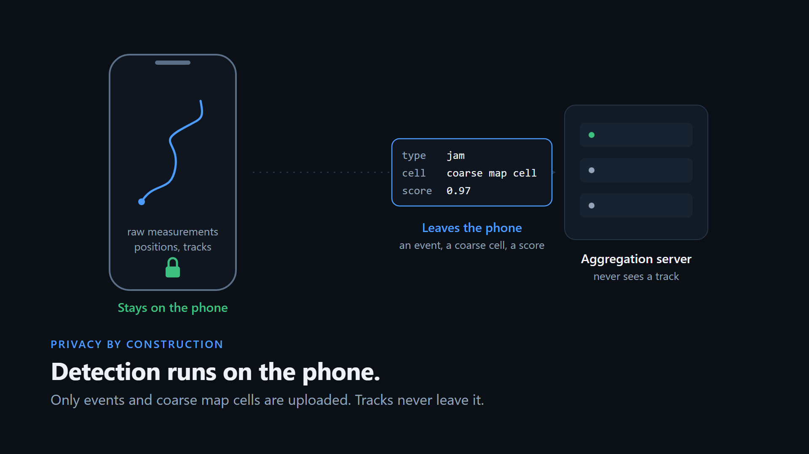
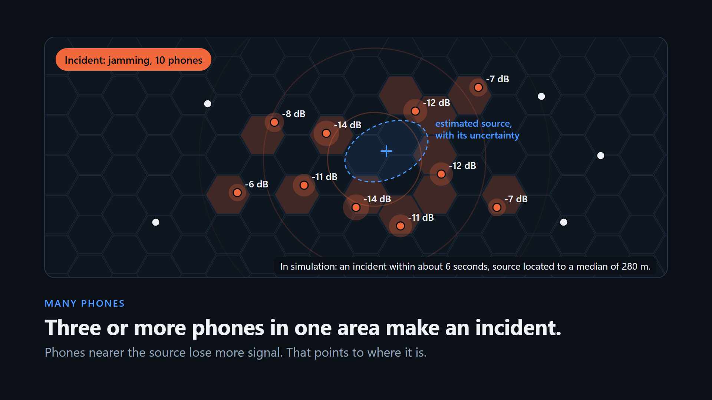
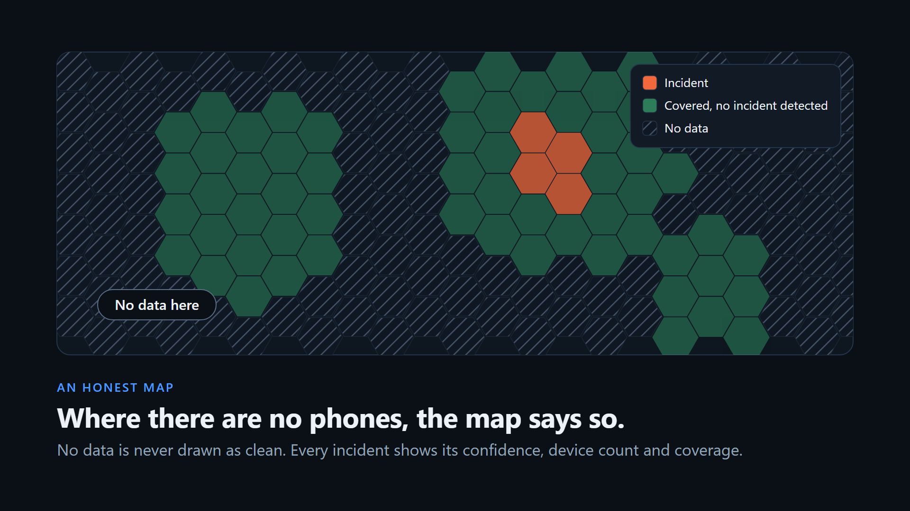
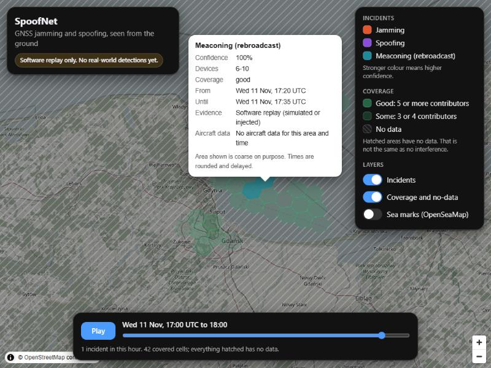

# SpoofNet



A ground-level map of GPS/GNSS jamming and spoofing, built from the raw
satellite measurements that ordinary Android phones expose.

Today's public interference maps are built from aircraft reports, so they see
the sky. SpoofNet is meant to see ports, shipping lanes, roads, fields and
sites. It is **passive detection only**: nothing here transmits, and every
interference signal used in development exists only in software.

## The idea in 72 seconds

[](docs/media/spoofnet-tutorial.mp4)

The clip shows three of nine scenes. The full explainer is
[docs/media/spoofnet-tutorial.mp4](docs/media/spoofnet-tutorial.mp4): 72
seconds, no sound, every statement on screen checked against this repository.
It is rendered from code in [tutorial/](tutorial/README.md).

## How it works, in pictures

**1. The gap.** Public interference maps are built from what aircraft report.
They show the sky. What happens in a port, on a road or in a field is blank.



**2. Phones already measure the satellites.** Every second an Android phone
reports the signal strength of each satellite it hears, its receiver gain
(AGC) and its clock. SpoofNet only listens to that. It never transmits.



**3. A jammer or just a roof?** Jamming adds power: every satellite falls by
the same amount and the receiver turns its gain down. A roof blocks unevenly
and adds nothing. A phone with no gain reading cannot tell the two apart, so
it reports "unknown loss" instead of guessing.



**4. Spoofing leaves fingerprints.** One transmitter makes all satellites look
equally strong. Position or time jumps. Constellations that were not spoofed
stop agreeing with the ones that were.



**5. Privacy by construction.** Detection runs on the phone. Raw measurements,
positions and tracks stay there. What leaves is an event: a type, a coarse map
cell and a score, under a token that changes every day.



**6. Many phones make an incident.** Three or more phones in one area open an
incident. Phones nearer the source lose more signal, and that pattern points to
where it is, with an uncertainty ellipse. The figures on the image are from
simulation.



**7. An honest map.** Where there are no phones the map says "no data". It
never draws that as clean.



The running map, here with simulated incidents and labelled as such (map data
© OpenStreetMap contributors):



**8. The one real observation so far.** On a public log of a flight from Riga
to Tampere on 22 March 2024, the detector raised one jamming event. It covers
the same map cells where 15 to 24 % of aircraft reported low accuracy that
day, and nothing else. One phone, one flight, at 8 km altitude: an
observation, not a validation. Details in
[docs/validation/real_world.md](docs/validation/real_world.md).


## Status, 11 November 2026

* **Works in software replay:** the simulator, the on-device detectors, the
  aggregation and source localisation, the API and the map.
* **Checked on real phone data:** five public logs. First contact broke the
  spoofing detector (a continuous false alarm); it was hardened and now raises
  none on them. On one real flight through a documented interference area it
  raised one jamming event that matches the aircraft-based map.
* **Not done:** the Android app has not been built or run on a phone. Nothing
  has been measured at ground or sea level under real interference. No real
  spoofing has been seen. There are no contributors and no customers.
* **Targets:** the spoofing and false-alarm minimum targets are met in replay.
  The jamming target is missed by a wide margin on phones without AGC.

[REPORT.md](REPORT.md) has the measured numbers, kept apart by evidence label,
and what failed.

## Read first

| Document | What it is |
|---|---|
| [REPORT.md](REPORT.md) | Measured results per milestone, what works on real data, what works only in replay, what failed, next steps |
| [DESIGN.md](DESIGN.md) | Detector design, false-alarm strategy, privacy, publication rules, validation plan, targets |
| [THREAT_MODEL.md](THREAT_MODEL.md) | What can and cannot be detected, and threats to the system and its contributors |
| [docs/validation/real_world.md](docs/validation/real_world.md) | The real-phone results in full, and how to get ground truth lawfully |
| [docs/device_matrix.md](docs/device_matrix.md) | Tested phones (empty until a real capability report exists) |
| [docs/pitch/](docs/pitch/) | One-pagers per sector and the technical validation note |
| [android/README.md](android/README.md) | The logger app and SDK, and what to check on the first build |

## Layout

```
android/            Kotlin SDK (logger, capability probe) and app. Not yet built.
spoofnet/io         GnssLogger-format log reader and writer, broadcast ephemeris
spoofnet/sim        constellations, phone models, environments, synthetic interference
spoofnet/detect     features, per-device and per-place baselines, fusion, events
spoofnet/replay     replay harness, calibration, scoring
spoofnet/net        H3 cells, privacy, events, clustering, localisation, ADS-B cross-check
spoofnet/server     storage, publication rules, HTTP API
web/                static map (MapLibre GL, OpenStreetMap, OpenSeaMap)
tutorial/           the explainer video and the images above, as code (Remotion)
docs/media/         the rendered video, preview clip and images
experiments/        the scripts that produce every reported number
results/            their output
config/             detector.json and real_tails.json (fitted, never hand-edited), publication_rules.json
tests/              unit tests
```

## Run it

Needs Python 3.10 or newer. Node.js is needed only if your Python has no build
of the `h3` package (the code then runs the same H3 library through Node).

```bash
python -m venv .venv
.venv/Scripts/python -m pip install -e ".[server,dev]" httpx     # Windows; use .venv/bin/python elsewhere
cd spoofnet/net/h3bridge && npm install && cd ../../..            # only without the h3 Python package
.venv/Scripts/python -m pytest -q
```

Reproduce the numbers (each script writes into `results/`):

```bash
python experiments/detector_pipeline.py --stage m3                     # fit, choose thresholds, test, ROC
python experiments/detector_pipeline.py --stage final --reuse-config   # 1 286 fresh clean hours
python experiments/plot_roc.py
python experiments/m4_place.py                                         # per-place baseline on repeated routes
python experiments/m5_network.py                                       # multi-device incidents, source localisation
python experiments/m7_demo.py                                          # load simulated incidents, write the map snapshot
python experiments/summarise.py                                        # print every headline number
```

With the public real-phone logs (fetch
[Zenodo 14712684](https://zenodo.org/records/14712684) into a folder first):

```bash
python experiments/m6_real_tails.py <folder>              # real clean tails -> config/real_tails.json
python experiments/m6_term_audit.py <folder>              # every evidence term, real against simulated
python experiments/m6_recorded_logs.py <folder> --exclude FLIGHT
python experiments/m6_flight.py <folder>/FLIGHT/gnss_log_2024_03_22_23_05_42.txt
```

See the map:

```bash
python -m uvicorn spoofnet.server.app:app --port 8787     # then open http://localhost:8787/
```

The map also works without a server from the snapshot in `web/data/`, on any
static host. Everything in that snapshot is simulated and is labelled so.

Inspect a phone log:

```bash
python -m spoofnet.io.gnsslogger --summary <log.txt>
python -m spoofnet.io.gnsslogger --capability <log.txt>
```

## Rules this project keeps

* Passive only. No transmitter is built, described or tested. Real-world tests
  only observe officially announced exercises from lawful places.
* Raw measurements and tracks never leave the phone. The server gets events and
  coarse coverage, under tokens that cannot be linked across days or regions.
* The public map shows coarse areas with at least three contributors, delayed.
  Precise source estimates go to vetted users and authorities only.
* Areas without contributors are drawn as "no data", never as clean.
* "Validated in replay" and "validated on real-world data" are never mixed.
* Thresholds come from data through `experiments/`, not from intuition.

## Data and map credits

Map data © OpenStreetMap contributors (ODbL). Sea marks © OpenSeaMap.
Rendering by MapLibre GL JS. Cell grid: H3. The OpenStreetMap tile server is
for light use; a deployment with real traffic needs its own tile source.
Real-phone logs: E. Takiguchi Medina and E. S. Lohan, Zenodo
10.5281/zenodo.14712684, CC BY 4.0. Aircraft comparison: GPSJam daily data.
OpenSky Network data may be used for research and non-profit work only; any
commercial use needs their written permission first.
